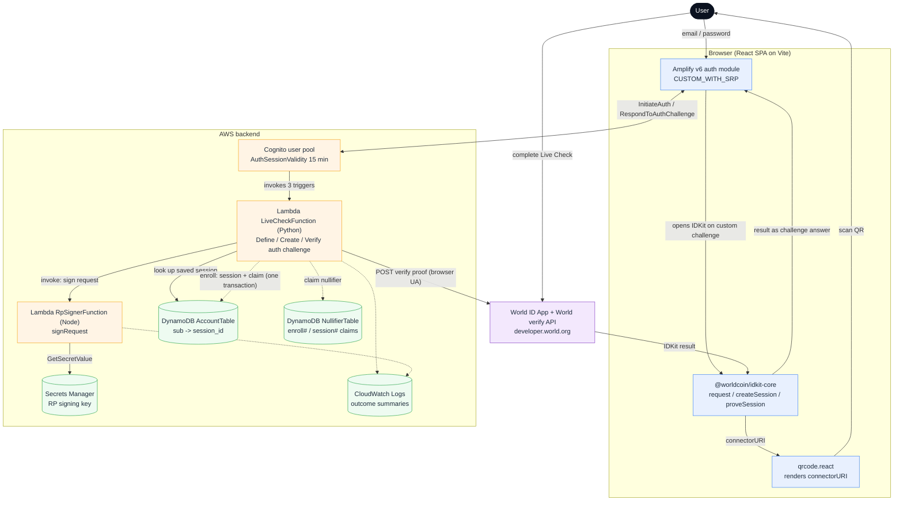
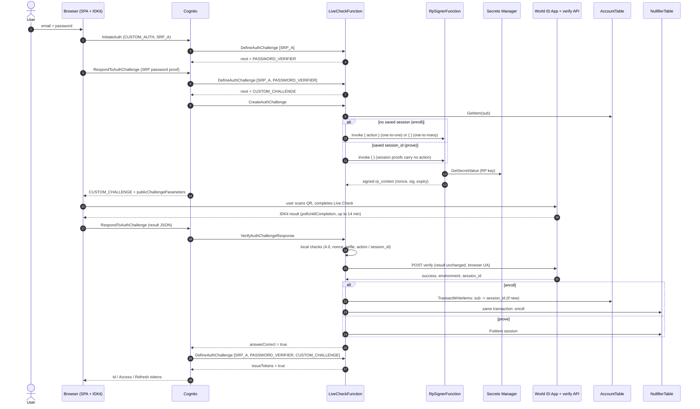

# Architecture

End-to-end architecture of the World ID **Live Check** integration, covering
**both** the browser frontend and the AWS backend, and every component involved in
issuing, collecting, and verifying a proof.

The Cognito `CUSTOM_CHALLENGE` in this app is a World ID Live Check using
[World ID 4.0 session proofs](https://docs.world.org/world-id/idkit/session-proofs).
The backend never sees a shared secret: the *client* collects a proof out of band
via IDKit, and the backend's job is to (a) authorize the request by signing it and
(b) verify the returned proof. On a user's first sign-in that proof **enrolls** a
World ID session for the Cognito account; on later sign-ins the user must **prove
that same session**.

## Components

### Frontend

- **Browser**: where the user enters email/password and scans the World ID QR
  code (or taps the deep link on mobile).
- **React SPA on Vite** (`live-check-frontend/`):
  - `src/auth.js` signs in with the **Amplify v6 auth module only**
    (`aws-amplify/auth`), using `signIn` with `authFlowType: 'CUSTOM_WITH_SRP'`.
    Amplify performs the SRP password computation, which the plain AWS SDK v3
    Cognito client doesn't implement.
  - `src/worldid.js` builds the IDKit request from the challenge parameters:
    `IDKit.request({ action, session_id: "create" })` (one-to-one enrollment),
    `IDKit.createSession(...)` (one-to-many enrollment), or
    `IDKit.proveSession(session_id, ...)` (returning user), each with
    `.constraints(CredentialRequest("selfie"))`. It also maps IDKit error codes to
    messages.
  - `src/App.jsx` runs the screens: password, new password (temporary-password
    users), Live Check, signed in. It renders `connectorURI` as a QR code with
    `qrcode.react`, polls for completion, and returns the IDKit result unchanged
    as the challenge answer.
- **`@worldcoin/idkit-core` 4.x from npm**: bundled by Vite; its WASM is inlined,
  so there are no files to copy into `public/`.
- **`.env`**: `VITE_USER_POOL_ID` and `VITE_USER_POOL_CLIENT_ID`. The region comes
  from the pool ID; no World ID values live in the frontend.
- **Vite dev server**: serves the SPA on `http://127.0.0.1:8080` (loopback only,
  fails fast if the port is taken).

### Backend (AWS)

- **Amazon Cognito user pool**: manages users and orchestrates the multi-step
  challenge flow. `AuthSessionValidity` is set to **15 minutes** (the Cognito
  maximum) because completing a Live Check in the World ID App easily exceeds the
  default 3-minute session. Self-registration is off (`AllowAdminCreateUserOnly`).
- **Lambda: `LiveCheckFunction`** (Python 3.12, arm64), one function wired to
  three Cognito triggers that define, create, and verify the custom challenge.
- **Lambda: `RpSignerFunction`** (Node.js 22.x, arm64), signs the World ID Relying
  Party request with `@worldcoin/idkit-core/signing` (`signRequest`): with the
  action for a uniqueness request, without one for a session request. Invoked by
  `CreateAuthChallenge`. Isolated in Node so the Python runtime needs no
  Keccak-256 / secp256k1 crypto libraries. It validates the key it reads (a
  32-byte hex private key) before caching it.
- **Secrets Manager**: stores the RP signing key, read only by the RP signer.
- **DynamoDB `AccountTable`** (key `sub`): one item per enrolled Cognito user,
  mapping `sub` to its World ID `session_id`. Written once at enrollment with a
  conditional put, and never silently replaced.
- **DynamoDB `NullifierTable`** (key `nullifier`), with prefixed keys:
  - `enroll#<nullifier>`: one-to-one enrollment claims (permanent).
  - `session#<session_nullifier>`: per-proof replay guards, expired by DynamoDB TTL.
- Both tables use point-in-time recovery and a customer managed AWS KMS key with
  rotation.
- **CloudWatch Logs**: every trigger logs a short outcome summary (step, mode,
  result, reason). Events, proofs, signatures, nonces, and World ID identifiers are
  not logged.
- **World ID App + World ID verify API**: the user completes the Live Check in the
  World ID App; the proof is verified at
  `https://developer.world.org/api/v4/verify/{rp_id}`.

## End-to-end diagram (frontend + backend)

The flow below traces one sign-in from the browser through Cognito, the Lambda
triggers, the RP signer, the World verifier, and the tables. Behavior of each step
is described in the sections that follow; this is the map, not a restatement.



> For the structural component view (tiers and the least-privilege IAM grants
> on each backend edge), see the Component view under Infrastructure in
> [`worldid-integration.md`](worldid-integration.md).

## Sequence diagram

Inline overview of the request/response exchange. For the fully annotated version,
with challenge-parameter payloads and per-step notes, see
[`auth_sequence.svg`](auth_sequence.svg) (source: [`auth_sequence.pu`](auth_sequence.pu)).



## The three triggers

All three are implemented in one function (`functions/triggers/app.py`) and
dispatched by the `triggerSource` prefix.

### DefineAuthChallenge, the orchestrator

Runs after every step and decides the next action. It accepts exactly one
sequence, with every step passed:

```
SRP_A -> PASSWORD_VERIFIER -> CUSTOM_CHALLENGE -> (issue tokens)
```

An empty session (a `CUSTOM_AUTH` start without `SRP_A`, which would skip the
password), a failed step, a repeated step, or any other sequence fails the sign-in.
Without this, an attacker who knows only a username could start the custom
challenge directly and enroll their own World ID to an account that hasn't
enrolled yet.

### CreateAuthChallenge, produce the World ID request

Builds the `CUSTOM_CHALLENGE`:

1. Refuses to run unless the session so far is a passed `SRP_A` +
   `PASSWORD_VERIFIER` (defense in depth).
2. Reads the user's item from the `AccountTable` with a consistent read. A read
   error raises and fails the sign-in, so an unreadable table is never mistaken for
   "not enrolled".
3. Chooses the mode and invokes the **RP signer**:
   - **enroll** (no saved session), one-to-one: signs with the enrollment action.
   - **enroll**, one-to-many: signs without an action (session-only request).
   - **prove** (saved session): signs without an action, and returns the saved
     `session_id`, which IDKit needs to prove it.
4. Returns the request context in `publicChallengeParameters` and what the verify
   step must check in `privateChallengeParameters` (see the table below).

### VerifyAuthChallengeResponse, verify the proof

Decides whether the answer is correct by setting `response.answerCorrect`. It
never raises; any failure leaves it `false` so Cognito fails cleanly.

1. **Local checks** (before any network call): the answer is a JSON object with
   `protocol_version: "4.0"` (legacy proofs are rejected), its `nonce` equals the
   nonce signed for this challenge, and it carries a Selfie Check credential
   (`identifier: "selfie"`). Then per mode:
   - enroll, one-to-one: `action` equals the enrollment action, a new `session_id`
     was created, and the response carries a `nullifier`.
   - enroll, one-to-many: no `action`, a new `session_id`, and a `session_nullifier`.
   - prove: no `action`, `session_id` equals the saved one, and a `session_nullifier`.
2. **World verify**: forwards the result **unchanged** to
   `/api/v4/verify/{rp_id}` (`_verify_proof_with_world`) with a browser-like
   `User-Agent` (see "The verify call sits behind Cloudflare" below). Requires
   `success: true`, the expected `environment`, and, when returned, matching
   `session_id` and `action`.
3. **Store**:
   - enroll: one `TransactWriteItems` puts the account item (`sub -> session_id`,
     only if the account isn't enrolled) and the nullifier claim (`enroll#` for
     one-to-one, `session#` with a TTL for one-to-many, only if it's new). Either
     condition failing rejects the answer and writes nothing.
   - prove: a conditional `PutItem` of the `session#` claim with a TTL; a second
     claim of the same proof is a replay and is rejected.

The enrollment type comes from `privateChallengeParameters` (set by
`CreateAuthChallenge`), not from the proof, so a client can't downgrade a
one-to-one deployment by answering with a session-only result.

## Enrollment and returning sign-ins (session proofs)

In World ID 4.0, nullifiers are **one-time-use**: a uniqueness request lets each
person complete a given action once, and its nullifier must not be reused as a
persistent user identifier. Continuity across sign-ins comes from a **session**:

| Value | Purpose | Where it's stored |
| --- | --- | --- |
| `session_id` | Identifies the session across checks. Saved against the Cognito account at enrollment and required on every later sign-in. | `AccountTable` |
| `nullifier` (enrollment, one-to-one) | Proves the person hasn't enrolled another account. | `NullifierTable` as `enroll#<nullifier>`, permanent |
| `session_nullifier` | Per-proof replay protection; never used as an identifier. | `NullifierTable` as `session#<value>`, expires via TTL |

The `EnforceUniqueEnrollment` stack parameter decides whether one person can enroll
more than one account:

| `EnforceUniqueEnrollment` | Enrollment request | One account per person? |
| --- | --- | --- |
| `true` (default) | `IDKit.request({ action, session_id: "create" })`: one uniqueness proof that also creates the session | Yes. World allows each person the action once, and the `enroll#` claim rejects a second account. |
| `false` | `IDKit.createSession(...)`: session-only, no action | No. Each account gets its own session. |

Returning sign-ins use `IDKit.proveSession(session_id, ...)` in both modes.
Selfie Check is a medium-assurance credential, so one-to-one adds resistance to one
person operating many accounts rather than a strict guarantee.

> World treats re-binding a session as an account-security operation. The account
> item is written only if absent, so an enrolled account is never silently
> re-bound. To re-enroll an account deliberately, delete its `AccountTable` item.

## The verify call sits behind Cloudflare (browser User-Agent required)

`developer.world.org` is fronted by Cloudflare. A request from Python's default
`urllib` User-Agent (`Python-urllib/x.y`) is blocked at the edge with **HTTP 403 /
Cloudflare error 1010** before it ever reaches the World verifier, which surfaces
to the user as a failed sign-in even though the proof is valid.
`_verify_proof_with_world` therefore sends a normal browser `User-Agent` (plus
`accept: application/json`). This is required, not cosmetic.

## Public vs private challenge parameters

| Bag | Visibility | Contents |
| --- | --- | --- |
| `publicChallengeParameters` | Returned to the client | `mode`, `app_id`, `rp_id`, `environment`, signed `rp_context` (`rp_nonce`, `rp_created_at`, `rp_expires_at`, `rp_signature`), plus `action` (one-to-one enroll) or `session_id` (prove) |
| `privateChallengeParameters` | Backend only | `mode`, `nonce`, plus `unique` and `action` (enroll) or `session_id` (prove) |

## Trust boundaries & data handling

- **The password can't be skipped.** Tokens are issued only after the exact passed
  sequence `SRP_A -> PASSWORD_VERIFIER -> CUSTOM_CHALLENGE`.
- The **RP signing key** lives in Secrets Manager and is read only by the Node RP
  signer. It is never logged, never returned to the client, and never placed in
  `publicChallengeParameters`.
- The **expected nonce, mode, and action or `session_id`** live only in
  `privateChallengeParameters`, which Cognito keeps server-side between the create
  and verify steps.
- The IDKit **result is forwarded to the verifier unchanged** (no field remapping).
- **Replay protection** comes from the short-lived signed RP nonce bound to each
  challenge and the per-proof `session_nullifier` claim.
- **An enrolled session is never silently replaced**: enrollment writes are
  conditional and transactional.
- **Logs carry outcomes only**: no events, proofs, signatures, nonces, or World ID
  identifiers.
- **IAM is least-privilege:** the RP signer gets `secretsmanager:GetSecretValue` on
  the one secret; the trigger function gets `lambda:InvokeFunction` on the signer,
  `dynamodb:PutItem` on the nullifier table, `dynamodb:GetItem` and
  `dynamodb:PutItem` on the account table (`TransactWriteItems` is authorized per
  item as `PutItem`), and use of the tables' KMS key.
- `PreventUserExistenceErrors: ENABLED` on the app client avoids leaking whether a
  username exists.
