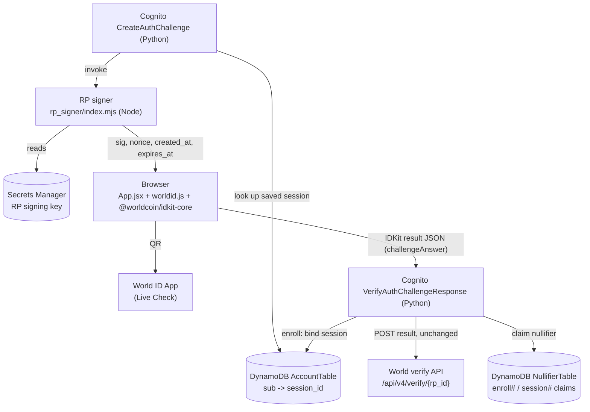
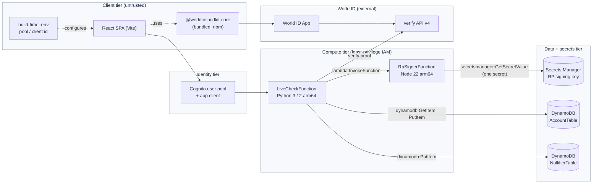

# How the World ID Live Check is wired in

This repo implements the World ID Live Check as the Cognito `CUSTOM_CHALLENGE`,
using [World ID 4.0 session proofs](https://docs.world.org/world-id/idkit/session-proofs).
This document explains how the pieces fit together and the security rules that go
with them.

## Mental model

The custom challenge is a World ID verification. The *client* collects a proof out
of band (via IDKit + the World ID App), so the backend never generates or stores a
shared secret. The backend's job is to (a) authorize the request by signing it and
(b) verify the returned proof. The first sign-in **enrolls** a World ID session for
the Cognito account; every later sign-in must **prove** that session:

| Step | Enroll (first sign-in) | Prove (later sign-ins) |
| --- | --- | --- |
| Deliver challenge | Backend signs a request (with the enrollment action for one-to-one, without for one-to-many); the browser opens IDKit and shows a QR code | Backend signs a session request (no action) and sends the saved `session_id`; the browser opens IDKit and shows a QR code |
| User acts | Scans the QR and completes a Live Check in the World ID App | Same |
| Verify | Backend verifies the result with World, then saves `sub -> session_id` and a nullifier claim in one transaction | Backend verifies the result with World, requires the saved `session_id`, and claims the `session_nullifier` against replay |

Three components collaborate:



---

## Seam 1, CreateAuthChallenge signs the request (backend)

File: `live-check-backend/functions/triggers/app.py`, function
`create_auth_challenge`.

1. **Password guard.** It raises `PasswordNotVerifiedException` unless the session
   so far is a passed `SRP_A` + `PASSWORD_VERIFIER`. DefineAuthChallenge already
   enforces this; the guard is defense in depth.
2. **Account lookup.** `_get_account(sub)` reads the `AccountTable` with a
   consistent read. A read error raises, so an unreadable table is never treated as
   "not enrolled" (which would let a new session be bound to the account).
3. **Sign the request** with the Node RP signer (`_sign_rp_request`):

   | Mode | When | Signed with | `publicChallengeParameters` adds | `privateChallengeParameters` |
   | --- | --- | --- | --- | --- |
   | enroll, one-to-one | No saved session, `EnforceUniqueEnrollment=true` | the enrollment action | `mode`, `action` | `mode`, `unique: "true"`, `nonce`, `action` |
   | enroll, one-to-many | No saved session, `EnforceUniqueEnrollment=false` | no action | `mode` | `mode`, `unique: "false"`, `nonce` |
   | prove | Saved `session_id` | no action | `mode`, `session_id` | `mode`, `nonce`, `session_id` |

   Every mode's public parameters also carry `app_id`, `rp_id`, `environment`, and
   the signed `rp_context` (`rp_nonce`, `rp_created_at`, `rp_expires_at`,
   `rp_signature`).

The RP signature authenticates our app to the World ID protocol; a client can't
forge it, and it expires (300 seconds by default). Signing is isolated in
`functions/rp_signer/index.mjs` because World ID's signing helper
(`@worldcoin/idkit-core/signing`, `signRequest`) implements the Keccak-256 +
secp256k1 EIP-191 signature the verifier expects. World ID 4.0 signs session
requests **without** an action and uniqueness requests **with** one, so the signer
takes the action as optional. It reads the key from Secrets Manager, checks it's a
32-byte hex private key (not the 40-character signer address) before caching it,
and never logs it or returns it to the client.

## Seam 2, VerifyAuthChallengeResponse verifies the proof (backend)

File: same `app.py`, function `verify_auth_challenge`.

The client answers `CUSTOM_CHALLENGE` with the IDKit result JSON. The backend checks
it in this order and rejects at the first failure, logging only a reason code:

1. **Local checks**, before any network call:
   - the answer is a JSON object with `protocol_version: "4.0"` (legacy 3.0 proofs
     are rejected);
   - its `nonce` equals the nonce signed for this challenge;
   - it carries a Selfie Check credential response (`identifier: "selfie"`);
   - per mode: one-to-one enrollment requires the enrollment `action`, a new
     `session_id`, and a `nullifier`; one-to-many enrollment and prove require no
     `action` and a `session_nullifier`; prove also requires the saved `session_id`.
2. **World verify.** `_verify_proof_with_world` forwards the result **unchanged**
   to `/api/v4/verify/{rp_id}`; the verifier expects the exact IDKit shape. It
   requires `success: true`, then the backend checks the response's `environment`
   matches `WorldIdEnvironment` and, when returned, that `session_id` and `action`
   match.
3. **Store**:
   - **Enroll**: `_enroll` runs one `TransactWriteItems`: put the account item
     (`sub -> session_id`) only if the account isn't enrolled, and put the nullifier
     claim only if it's new, `enroll#<nullifier>` (permanent) for one-to-one or
     `session#<session_nullifier>` with a TTL for one-to-many. If either condition
     fails, nothing is written and the answer is rejected (`account_already_enrolled`,
     `person_already_enrolled`, or `session_proof_replayed`).
   - **Prove**: `_claim_session_nullifier` puts `session#<session_nullifier>` with a
     TTL only if it's new; a second claim is a replay (`session_proof_replayed`).

`answerCorrect` is `True` only when every check passes and the write succeeds. The
function never raises, so Cognito can fail the challenge cleanly.

> **Why sessions, not nullifiers?** In World ID 4.0, nullifiers are one-time-use: a
> uniqueness request lets each person complete an action once, so a nullifier can't
> serve as a returning user's identifier. The stable link across sign-ins is the
> `session_id`, saved against the account at enrollment. The `session_nullifier` on
> each later proof is only a replay guard. The enrollment type (`unique`) comes from
> the private parameters CreateAuthChallenge set, not from the proof, so a client
> can't downgrade a one-to-one deployment by answering with a session-only result.

### Cloudflare note, the verify call needs a browser User-Agent

`developer.world.org` is fronted by Cloudflare, which blocks Python's default
`urllib` agent (`Python-urllib/x.y`) with **HTTP 403 / error 1010** *before* the
request reaches the verifier. `_verify_proof_with_world` therefore sends a normal
browser `User-Agent` (and `accept: application/json`). Without it, every proof, even
a valid one, fails with a 403, surfacing as a failed sign-in.

## Seam 3, Render the QR and return the proof (frontend)

Files: `live-check-frontend/src/auth.js`, `src/worldid.js`, and the `LiveCheck`
component in `src/App.jsx`.

`auth.js` signs in with the Amplify v6 auth module, `signIn({ ..., options: {
authFlowType: 'CUSTOM_WITH_SRP' } })`, which runs the SRP password step and then
returns `CONFIRM_SIGN_IN_WITH_CUSTOM_CHALLENGE` with the public parameters in
`nextStep.additionalInfo`. `worldid.js` turns those parameters into an IDKit request:

```js
import { IDKit, CredentialRequest } from '@worldcoin/idkit-core'

const common = {
  app_id: p.app_id,
  environment: p.environment,
  rp_context: {
    rp_id: p.rp_id,
    nonce: p.rp_nonce,
    created_at: Number(p.rp_created_at),
    expires_at: Number(p.rp_expires_at),
    signature: p.rp_signature
  }
}
const selfie = CredentialRequest('selfie')

const request = p.mode === 'prove'
  ? await IDKit.proveSession(p.session_id, common).constraints(selfie)
  : p.action                                   // enroll
    ? await IDKit.request({ ...common, action: p.action, session_id: 'create', allow_legacy_proofs: false }).constraints(selfie)
    : await IDKit.createSession(common).constraints(selfie)
```

`App.jsx` renders `request.connectorURI` as a QR code (`qrcode.react`), waits with
`request.pollUntilCompletion({ timeout })`, then submits the result unchanged with
`confirmSignIn({ challengeResponse: JSON.stringify(outcome.result) })`.

IDKit details worth remembering:

- `IDKit.request(...)`, `createSession(...)`, and `proveSession(...)` return a
  *builder*; `.constraints(...)` returns a `Promise<IDKitRequest>`. Since IDKit
  4.4.0, session builders require `.constraints(...)`; `.preset(...)` throws.
- `pollUntilCompletion()` resolves to a discriminated union and **never throws**:
  check `outcome.success` before using `outcome.result`, and map `outcome.error`
  (an IDKit error code) to a message (`liveCheckErrorMessage`).
- **One IDKit request per signed challenge.** World rejects a reused RP nonce
  (`duplicate_nonce`), so the app opens the request once per challenge and doesn't
  wrap the app in `React.StrictMode`, which mounts components twice in development.
- The poll timeout is 14 minutes, just under the 15-minute Cognito auth session.

The frontend uses `@worldcoin/idkit-core` rather than the `@worldcoin/idkit` React
widgets because the result must go back to Cognito through `confirmSignIn`, as the
challenge answer, rather than to a backend endpoint from a widget callback. Vite
bundles the package, including its inlined WASM, so nothing is copied into
`public/`.

---

## Infrastructure

`template.yaml` provisions:

- **UserPool / UserPoolClient**: the client sets `AuthSessionValidity: 15`
  (minutes, the Cognito max) because the out-of-band Live Check exceeds the
  default 3-minute custom-auth session; `PreventUserExistenceErrors: ENABLED`; and
  auth flows `ALLOW_USER_SRP_AUTH`, `ALLOW_CUSTOM_AUTH`, `ALLOW_REFRESH_TOKEN_AUTH`.
  Self-registration is off (`AllowAdminCreateUserOnly: true`).
- **AccountTable** (DynamoDB, `PAY_PER_REQUEST`, key `sub`): one item per enrolled
  user, `sub -> session_id`.
- **NullifierTable** (DynamoDB, `PAY_PER_REQUEST`, key `nullifier`, TTL on
  `expires_at`): `enroll#` claims (permanent) and `session#` replay guards (expire).
- Both tables: point-in-time recovery and a customer managed KMS key with rotation.
- **RpSignerFunction** (Node.js), the RP signer, granted
  `secretsmanager:GetSecretValue` on the signing-key secret only.
- **LiveCheckFunction** (Python), the three triggers, granted
  `lambda:InvokeFunction` on the signer, `dynamodb:PutItem` on the nullifier table,
  `dynamodb:GetItem` and `dynamodb:PutItem` on the account table, and use of the KMS
  key.

Parameters: `WorldIdAppId`, `WorldIdRpId`, `WorldIdAction` (the v4 enrollment
action, default `livecheck-signin`), `EnforceUniqueEnrollment` (`true` | `false`,
default `true`), `WorldIdEnvironment` (`staging` | `production` | `sandbox`),
`RpSigningKeySecretArn`.

### Component view

Structural view of what `template.yaml` provisions above: the tiers the data
crosses and the least-privilege IAM grant on each backend edge.



## What the tests cover

Backend (`live-check-backend/tests/test_triggers.py`, run without AWS or network;
DynamoDB is an in-memory fake with conditional-put and transaction semantics):

- **DefineAuthChallenge**: the strict `SRP_A -> PASSWORD_VERIFIER -> CUSTOM_CHALLENGE`
  order; an empty session (no password), a failed step, and unexpected sequences
  are denied.
- **CreateAuthChallenge**: enroll (one-to-one, signed with the action) vs enroll
  (one-to-many, no action) vs prove (no action, saved `session_id`); string-only
  parameters; refuses before the password step; an account-table read error and a
  signer failure fail closed.
- **VerifyAuthChallengeResponse**, enrollment: binds the session and claims the
  nullifier; a second account for the same person is rejected (one-to-one) or
  allowed (one-to-many); an enrolled account is never re-bound; a replayed session
  creation is rejected; local checks reject a bad proof without calling World; World
  rejections, environment mismatches, and session or action mismatches store
  nothing; a client can't downgrade one-to-one with a session-only result, or the
  reverse.
- **VerifyAuthChallengeResponse**, returning user: a valid session proof is accepted
  and its replay is rejected; a session from another account, a proof without a
  `session_nullifier`, and a proof carrying an action are rejected.
- **Logging**: create and verify logs contain no signature, nonce, `session_id`, or
  `session_nullifier`.

Frontend (`live-check-frontend/src/worldid.test.js`): the three IDKit request types
and their exact configs, string-to-number timestamp conversion, rejection of missing
parameters before IDKit is called, that the real IDKit 4.x builders accept the
configs, and the user-facing message for each handled error code.

## Security rules (enforced here)

- **No password skip.** Tokens are issued only after the exact passed sequence
  `SRP_A -> PASSWORD_VERIFIER -> CUSTOM_CHALLENGE`; CreateAuthChallenge also refuses
  to run before the password step.
- The RP signing key stays in Secrets Manager, is read only by the Node signer, and
  is never logged or placed in `publicChallengeParameters`.
- **World ID 4.0 only.** Legacy (3.0) proofs are rejected.
- **Each proof is bound to its challenge** by the signed, short-lived RP nonce, and
  each accepted session proof's `session_nullifier` is claimed once, so a proof
  can't be replayed.
- **A session is never silently re-bound.** Enrollment is a conditional,
  transactional write; re-enrolling an account requires deleting its `AccountTable`
  item.
- The result is forwarded to the verifier **unchanged** (no field remapping), with
  a browser `User-Agent` so Cloudflare (error 1010) doesn't block it.
- **Fail closed.** Any parse, verify, or storage error rejects the answer; an
  unreadable account table fails CreateAuthChallenge rather than enrolling.
- **Logs carry outcomes only**: no events, proofs, signatures, nonces, or World ID
  identifiers.
